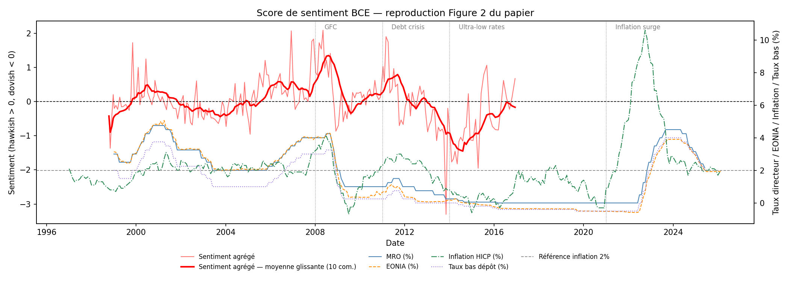
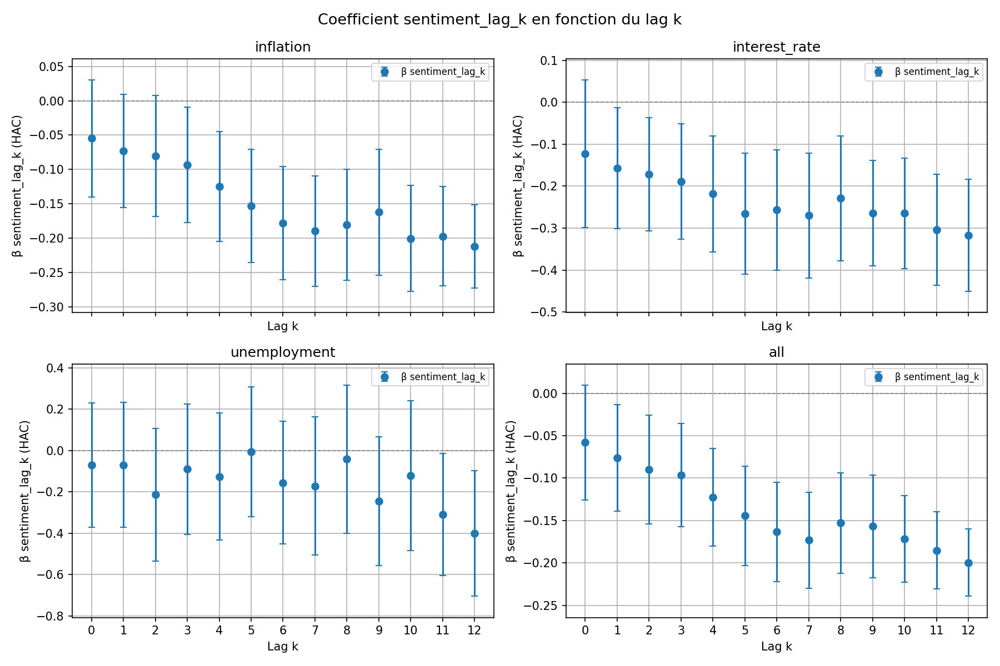

# ECB communication and money market rates: a text-sentiment replication

Does the tone of the ECB's press conferences tell markets anything beyond the policy rate decision itself?
This project reimplements the sentiment indicators and the main regression of Czudaj & Nguyen (2025), *ECB's central bank communication and monetary policy transmission: predictability from text-based sentiment indicators*, Macroeconomic Dynamics ([doi:10.1017/S1365100525000239](https://doi.org/10.1017/S1365100525000239)).

The replication recovers the paper's main result: once the policy rate is controlled for, hawkish ECB communication predicts a **lower** overnight interbank rate (EONIA) at the following meetings.
The policy rate passes through to EONIA with a coefficient of 1.15 (about 1.14 in the paper).



## Method

**1. A hawkish/dovish score for each press conference** (`src/preprocessing`, `src/sentiment`)

- Each transcript is split into sentences. Around each occurrence of a target keyword (*inflation*, *interest rate(s)*, *unemployment*), the 10 words before and after are kept, and stop words are removed.
- The words of the window are matched against the paper's dictionary of hawkish and dovish terms (its Table A1, including truncated patterns such as `ris*` or `increas*`).
- A window scores (hawkish matches − dovish matches) divided by its number of words. Scores are averaged per keyword and per press conference, which gives three topic indices and an aggregate one.

**2. Predictive regressions** (`src/analysis`)

For each index *X* and each lag *k* = 0, …, 12 press conferences:

```
EONIA_t = β0 + β1 · X_{t−k} + β2 · MRO_t + ε_t
```

MRO is the ECB's main refinancing rate. The regression is estimated by OLS with HAC standard errors (4 lags).
β1 measures what the past tone adds to the current policy rate.

## Validation against the paper

| Check | This replication | Paper |
|---|---|---|
| Example sentence of section 3.2, inflation score | −0.333 | −0.33 |
| Inflation index, mean / std | 0.13 / 0.54 | 0.06 / 0.51 |
| Aggregate index, mean / std | 0.00 / 0.73 | −0.16 / 0.70 |
| Correlation with the paper's Figure 2 (digitized), 1998-2016 | 0.69 | |
| Pass-through coefficient β2 | 1.15 | ≈ 1.14 |

The transcripts come from the corpus of ECB press conferences compiled by Warin and Sanger, which stops in December 2016.
The replication therefore uses 205 press conferences (October 1998 to December 2016) instead of the paper's 266 (up to September 2022).

## Results



Coefficient β1 and its 95% HAC confidence interval, for each index and lag:

- **Inflation and interest rate sentiment**: negative and significant from a lag of 3 (inflation) or 1 (interest rate) press conferences, and larger in magnitude at longer lags.
- **Aggregate sentiment**: negative and significant from lag 1.
- **Unemployment sentiment**: mostly not significant.

These signs match the paper.
Its interpretation: the pass-through of the policy rate is slightly above one, so the market slightly overreacts to rate decisions, and the negative sentiment coefficients act as a correction.

**Limitations.**
A bag-of-words score misreads context: "inflation is too low and must rise" counts as hawkish, although it calls for looser policy.
This matters after 2014, when the index rises while rates stay at zero and the ECB communicates about a future normalization rather than moving rates.
The sample stops in 2016, so the negative-rate years are only partly covered, and the paper's robustness check with the deposit facility rate is not reproduced.

## Usage

```bash
pip install -r requirements.txt
python main.py
```

`main.py` scores the press conferences (or reloads `data/output/sentiment_scores.csv` if it exists), runs the regressions, and writes the HAC results and the coefficient figure to `data/output/`.
`notebooks/02_sentiment_validation.ipynb` runs the validation checks and draws the sentiment figure; it is kept with its outputs.

EONIA and €STR come from FRED, and the MRO rate, deposit facility rate and HICP inflation from the ECB Data Portal; and `data/raw/sentiment_red_curve.csv` is the aggregate index of the paper's Figure 2, digitized for comparison.
Code comments and notebook text are in French.
